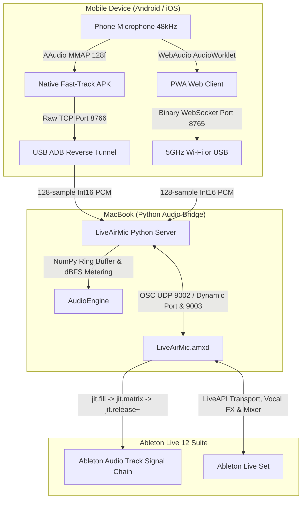

# LiveAirMic Architecture & Protocol Specification

## 1. High-Level Architecture Overview

LiveAirMic connects a mobile device (Android USB Native Fast-Track or cross-platform Wi-Fi PWA) directly into Ableton Live via Max for Live (`LiveAirMic.amxd`) with ultra-low latency, studio-grade 48kHz audio fidelity, and full bidirectional transport and FX synchronization—requiring **zero virtual audio drivers**.

---

## 2. Audio Pipeline & Latency Breakdown

### 2.1 Mode A: USB Native Fast-Track (`~8.5 – 11.5 ms` Total Acoustic Latency)
- **Capture**: Lock-free C/JNI `AAudio` MMAP (`AAUDIO_PERFORMANCE_MODE_LOW_LATENCY`, `AAUDIO_INPUT_PRESET_UNPROCESSED`) at `48,000 Hz` mono.
- **On-Device Studio Conditioning**: Zero-latency 85 Hz High-Pass rumble filter + 2-stage 7.5 kHz Warm Ribbon Low-Pass filter to tame raw MEMS capsule resonance before preamp gain.
- **Transport**: Raw TCP over `adb reverse tcp:8766 tcp:8766` (`TCP_NODELAY`), transmitting `128 samples` (`256 bytes` = `2.67 ms`) per packet with `< 0.3 ms` USB transit time.

### 2.2 Mode B: 5GHz Wi-Fi Browser PWA (`~11.8 – 14.3 ms` Network/Bridge Latency)
- **Capture**: `AudioWorkletProcessor` running on a dedicated WebAudio render thread at `48,000 Hz` (`echoCancellation: false`, `noiseSuppression: false`, `autoGainControl: false`).
- **Transport**: Binary WebSocket (`wss://`) with a 4-byte sequence/channel header + `128 samples` (`2.67 ms`) of 16-bit linear PCM per frame.
- **Latency Breakdown**:
  - `AudioWorklet` quantum: `2.67 ms` (`128 samples` @ `48,000 Hz`)
  - 5GHz Wi-Fi one-way air transit: `1.5 – 4.0 ms`
  - Max for Live `jit.release~ @latency 5.` jitter buffer: `5.00 ms`
  - Ableton Live host vector buffer (`128 samples`): `2.67 ms`
  - **Software/Network Total**: `~11.8 – 14.3 ms` *(plus `10 – 25 ms` mobile browser OS input capture buffer).*

### 2.3 Direct Max for Live Audio Injection (`jit.release~`)
- `server/bridge.py` converts incoming 16-bit PCM into normalized `Float32` 128-sample blocks and streams them via UDP `/airmic/pcm` directly into `LiveAirMic.amxd`.
- Inside `LiveAirMic.amxd`, `jit.fill airmic_mat 0` populates a 128-sample `float32` matrix that feeds `jit.release~ 1 @mode 0 @latency 5.` directly into `plugout~`, outputting sample-accurate audio onto the Ableton track with zero external CoreAudio loopback drivers.

---

## 3. Bidirectional Control & Ableton LOM Sync

### 3.1 Max for Live (M4L) OSC Bridge
- **Python $\rightarrow$ M4L (Dynamic Port / 9002)**:
  - `/airmic/pcm <128 float32 samples>`
  - `/airmic/active <0|1>`
  - `/airmic/meter_text`, `/airmic/status_text`, `/airmic/latency_text`
  - `/airmic/remote_rec <0|1>`
  - `/airmic/fx_ctl fx_ctl <cmd> <val>` (live vocal FX and 7-track mixer automation)
- **M4L $\rightarrow$ Python (Port 9003)**:
  - `/live/port <dynamic_udp_port>`
  - `/live/transport <is_playing> <is_recording> <tempo> <beat>`
  - `/live/arm <is_armed>`
  - `/live/rec_toggle <0|1>`
